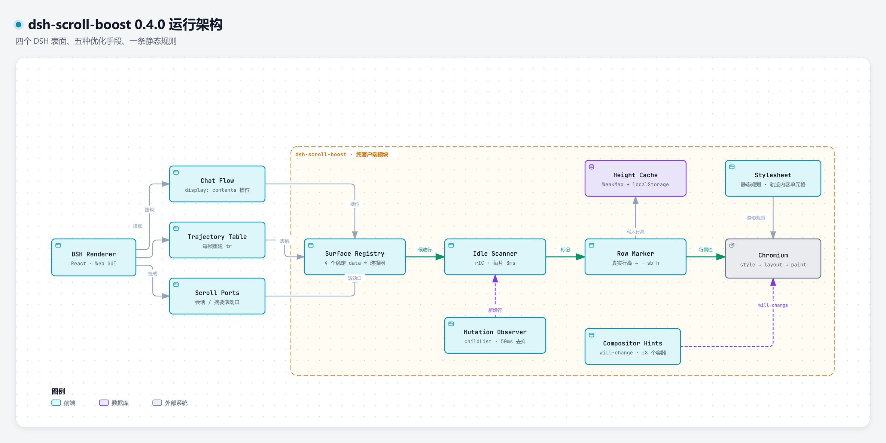

# dsh-scroll-boost

一个**纯客户端**的 DeepSeek Harness Web GUI 滚动优化插件。

它不卸载插件、不改 React 组件、不改主题，也不降低画面质量：只在空闲时给「真正可滚动容器里的长列表直接子行」加上
`content-visibility: auto`，让浏览器跳过屏幕外行的布局与绘制，从而减少滚动时的合成和重排压力。

> 当前版本：`0.3.0`（识别 DSH 自身的界面结构：聊天流等表面直接接管，行高以真实高度为准）

[](https://github.com/TWFU-wcy/dsh-scroll-boost)
[](LICENSE)

## 解决什么问题

安装 `@changfenhuang/dsh-genui` 等会在 DOM 中生成大量围栏内容的插件后，长会话滚动可能出现掉帧。
根因通常是浏览器仍在对整页 DOM 做布局/绘制，而滚动帧预算只有约 16.7ms。

`dsh-scroll-boost` 的做法是：**只让屏幕外的“行”不参与渲染**，屏幕内的画面完全不变。

## 运行架构



点击查看[可交互版本](docs/architecture.html)（可切换主题、搜索节点、查看源码引用）。

## 0.3.0 重构：从「猜列表」到「认表面」

0.2.x 的做法是「在页面里找一个看起来可滚动的容器，再把它的直接子节点当成行」。
问题在于 **DSH 把聊天记录渲染进一个 `display: contents` 的槽位**——槽位自己没有盒子，
所以那套「向下走直到找到行列表」的搜索永远看不到它，**长会话聊天页基本没被优化过**。

0.3.0 改为直接认 DSH 自己的稳定 `data-*` 表面，并按表面类型决定策略：

| 表面 | 选择器 | 策略 | 原因 |
| --- | --- | --- | --- |
| `chat-flow` | `[data-slot="conversation.chat.flow"]` | 标记其直接子行 | 聊天记录没有虚拟化，行数随会话增长，是收益最大的地方 |
| `conversation-scroll` | `[data-conversation-scroll]` | 只加 `will-change` 提示 | 这是真正的滚动口 |
| `trajectory` | `[data-trajectory-scroll]` | **整面跳过** | DSH 自己做虚拟化，插手只会打架 |
| `summary-region` | `[data-summary-scroll-region]` | 只加提示 | 摘要区是短列表，不需要跳行 |

认不出来的界面仍走 0.2.x 的通用回退路径，所以版本升级不会让插件彻底失效。

### 行高必须是真值

DSH 自己的「当前读到第几行」是拿 `getBoundingClientRect()` 做二分的。
一旦占位高度和真实高度对不上，**跳转、跟随尾巴就会落到错误的行**——画面不对，比掉帧更严重。

0.3.0 因此把行高当成一等公民：

- 离屏行不读布局，直接用**按 `data-chat-flow-key` 记住的历史高度**（WeakMap + localStorage）；
- 可见带才实测一次，且减去 padding / border（`contain-intrinsic-size` 描述的是内容盒）；
- 高度以 0.01px 精度写入 `--sb-h`，避免上千行累积出可见的滚动条漂移；
- `ResizeObserver` 盯着近端行，行高变化时立即纠正。

实测（600 行聊天记录，headless Edge）：标记后 `scrollHeight` **完全不变**，
行位置最大偏差 **9px**，DSH 的二分定位依然命中正确的行。

### 护栏：宁可不动，也不能动错

以下行会被主动跳过，并在 `report().skipReasons` 里说明原因：

| 原因 | 场景 |
| --- | --- |
| `sticky` | 行内有 sticky 子元素（折叠头、代码块横幅）——成为包含块会把 sticky 困住 |
| `motion` | 行正在折叠 / 展开动画中（`data-chat-motion`）——此时行高在变 |
| `virtualized` | 位于 DSH 已经虚拟化的表面内（轨迹页） |
| `hidden` | 行处于 `hidden` 状态 |

另外 `contenteditable`、`aria-live` 区域、`display: table-*` 的行也一律不标记。

## 优化分层（A–E）

| 层 | 做什么 | 关键点 |
| --- | --- | --- |
| A. 离屏跳过（核心） | 给长列表的直接子行加 `content-visibility: auto` + `contain-intrinsic-size` | 先确定真实行高写入 `--sb-h`，再打标记；不改变可见区域 |
| B. 容器提示 | 给面积最大的最多 8 个滚动容器加 `will-change: scroll-position` | 只加属性，不每帧写 DOM |
| C. 空闲调度 | `requestIdleCallback` 分片扫描，每片约 8ms | 滚动期间暂停扫描/测量，滚动结束后继续 |
| D. 增量维护 | `MutationObserver` 监听 `childList` + 少量关键属性，50ms 去抖 | 新消息到达后只补新增行，不重扫全页 |
| E. 首屏快扫（0.2.0） | 视图挂载后下一帧只标记视口上下 1.5 屏内的行 | 上限 120 行 / 300 次 rect 读，剩下的交给空闲分片 |

扫描顺序是：表面发现 → 候选容器 → 行列表 → 逐行测量/标记。每一步都按空闲时间分片，避免启动时产生长任务。
首屏快扫是例外：它只跑一帧、只碰近端行，用来把「第一次可见帧就已经被优化」从几百毫秒提前到十几毫秒。
0.3.0 另加**批量读写**：一个分片里的行先全部读完、再全部写入，把每行一次布局重算压成每批一次。

## 安装

> 安装后必须**完全退出并重启 DSH**（不是只刷新页面）。插件通过 `package.json` 的
> `dsh.bundle.patch` 和 `dsh.client` 自动挂载；host 端入口是空实现，实际逻辑在 `lib/client.js`。

### 方式一：从 GitHub 直接安装

```powershell
dsh plugin --profile desktop add "github:TWFU-wcy/dsh-scroll-boost"
```

### 方式二：本地目录（开发时）

```powershell
git clone https://github.com/TWFU-wcy/dsh-scroll-boost.git
dsh plugin --profile desktop add ".\dsh-scroll-boost"
```

### 方式三：打包后安装

```powershell
npm pack
dsh plugin --profile desktop add ".\dsh-scroll-boost-0.3.0.tgz"
```

### 安装后确认

重启后打开任意长会话，在开发者工具 Console 执行：

```js
window.__scrollBoost.report()
```

> 如果 `window.__scrollBoost` 是 `undefined`：先确认已**完全退出并重启 DSH**，而不是只刷新页面。
> 如果 `report().rows` 为 `0`：欢迎页、空会话或很短的消息列表没有可标记的行，这是正常的；
> 打开一个有较长消息列表的会话后再看。

正常应看到类似：

```js
{
  version: "0.3.0",
  enabled: true,
  containers: 1,
  hinted: 1,
  rows: 599,
  marked: 599,
  skipped: 2,
  scans: 1,
  lastScanMs: 103,
  scrolling: false,
  fastPasses: 1,
  fastRows: 27,
  surfaces: [
    { id: "chat-flow", kind: "rows", rows: 600, marked: 599 },
    { id: "conversation-scroll", kind: "hint", rows: 0, marked: 0 }
  ],
  skipReasons: { sticky: 2 },
  pending: false
}
```

> `surfaces` 是 0.3.0 新增的：如果 DSH 改了内部结构，这里能直接看出插件认出了哪些界面、
> 认错了多少行（`marked` 小于 `rows` 的部分通常是被护栏跳过的）。

## 手动控制

```js
window.__scrollBoost.report();   // 查看统计
window.__scrollBoost.disable();  // 立即恢复 DOM（移除所有标记与样式）
window.__scrollBoost.enable();   // 重新启用
window.__scrollBoost.scanNow();  // 手动触发一次空闲扫描
window.__scrollBoost.destroy();  // 彻底卸载当前实例
```

## 插件简介与图标

DSH 的插件列表从 `locale/<语言>.json` 读取显示文案（`meta.title` / `meta.description`），
缺失时回退到 `package.json` 的 `name` / `description`；图标取自 `package.json` 的 `icon` 字段。

本插件提供 `locale/en.json` 与 `locale/zh.json`，中文界面下显示为「滚动加速」及对应说明；
`icon.svg` 为 873 B 的矢量图标，位于包内。修改文案后需要**完全重启 DSH** 才会重新读取。

## 验收建议

在同一个会话、同一滚动位置做 A/B（各 3 次取中位数）：

- 滚动 p95 帧耗时 ≤ 16.7ms，或相对基线改善 ≥ 30%
- Long Task 数量为 0
- CLS = 0（标记前后布局不跳动）
- 同位置截图 diff = 0（画面不变）
- 1000 行列表内存增长 < 50MB

## 已知边界

- **只管 CSS 能管的瓶颈**：如果掉帧来自 React 重渲染、genui 的全文档扫描、轨迹面板全量 `map`，
  本插件不会直接消除；它减少的是浏览器布局/绘制压力。
- **首屏“优化生效”有延迟（0.2.0 已大幅改善）**：不是首屏渲染变慢，而是标记要等分片跑完。
  0.2.0 的首屏快扫会在视图挂载后的下一帧就标记近端行，实测首次可见行标记从约 200ms 降到约 14ms；
  离屏行仍然由空闲分片慢慢补齐，所以“整页都标记完”仍需要一点时间。
  0.3.0 进一步把变更后的去抖从 300ms 降到 50ms，切到轨迹/会话视图后更快跟上。
- **依赖 DSH 的内部结构**：0.3.0 认的是 `[data-slot="conversation.chat.flow"]`、
  `[data-conversation-scroll]`、`[data-trajectory-scroll]` 这些内部属性。DSH 改版后可能失效——
  但插件会保留通用回退路径，且 `report().surfaces` 能直接看出当前认出了什么。
- **不降低内存和加载时间**：DOM 节点仍在，只是离屏行不参与渲染。
- **特殊布局可能误判**：嵌套行列表、绝对定位虚拟列表、`display: table-*`、sticky/fixed 行会被跳过或只标记部分行。
- **Ctrl+F / 无障碍**：`content-visibility: auto` 的离屏内容仍可被浏览器查找；但极端情况下屏幕阅读器
  对“尚未渲染”的内容行为可能不同，遇到问题可 `disable()`。
- **GPU 内存**：`will-change` 只在最多 8 个最大容器上使用；现代 Chromium 对 `scroll-position` 通常
  不直接建整层，实测净增通常 0–50MB，远低于 8GB 显卡压力。

## 开发与测试

```powershell
cd "D:\Project\dsh-scroll-boost"
npm install
npm test
```

`npm test` 会做语法检查、插件元信息检查（`locale` 字典与 `icon` 约束）、
0.3.0 回归测试（表面识别、护栏跳过、行高真值复用）和 jsdom 冒烟测试
（20 行列表、新增行、disable/enable、cleanup）。

浏览器侧的真实回归（需要本机装有 Edge）：

```powershell
npm run test:browser
```

- `harness-chat.html`：复刻 DSH 聊天页 DOM（`display: contents` 槽位 + 600 行），
  检查首屏标记时机、粘性横幅行是否被跳过、滚动口是否被提示；
- `probe-drift.html`：对比标记前后的每行位置与 `scrollHeight`，
  确认占位高度没有让 DSH 的行定位落到错误的行。

## 卸载

```powershell
dsh plugin --profile desktop remove dsh-scroll-boost
```

或先执行 `window.__scrollBoost.destroy()`，再移除插件并重启。

## License

MIT
